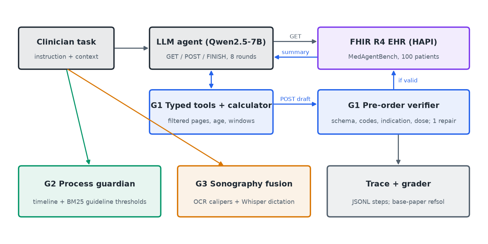

# MedGuardian

AI4015 Agentic AI, Project G3-07, Phase 2.

MedGuardian is an agentic co-pilot for EHR actions that runs **entirely on one laptop** (Apple M4,
16 GB) with a 7B open-weight model and **no API spend**. It extends the base paper,
[MedAgentBench](https://github.com/stanfordmlgroup/MedAgentBench) (Jiang et al., *NEJM AI* 2025,
doi:10.1056/AIdbp2500144), with one component per research gap fixed in Phase 1:

| Gap | Component | Code |
|---|---|---|
| **G1** Action reliability | Typed FHIR tools, calculator, pre-order verifier with one repair round | `src/medguardian/tools/fhir_summary.py`, `tools/task_context.py`, `verify/order_verifier.py` |
| **G2** Process guardian | Medication/lab timeline verifier with BM25-retrieved guideline thresholds | `src/medguardian/guardian/`, `tools/guideline_rag.py`, `data/corpora/guidelines/` |
| **G3** Sonography fusion | Screenshot OCR + dictation ASR + template-constrained fusion | `src/sonography/pipeline.py`, `templates.py` |

Every component is a switch in `src/medguardian/config.py` (`MedGuardianConfig`) for ablation.



## Gap-resolution table

Generated from `results/` by `experiments/make_tables.py` (do not edit by hand).

<!-- GAP_TABLE_START -->
| Gap | Method / component | Metric | Base paper result | Our result | Addressed? |
|---|---|---|---|---|---|
| Gap 1: action reliability | Typed FHIR tools, calculator, pre-order verifier | Action SR (%), test 50 | 0.0 (E2, reproduced) | 44.0 (E3) | Fully (Δ44.0 pp; H1: >=+15) |
| Gap 2: process guardian | Timeline verifier + BM25 guideline retrieval | F1, 30 synthetic records | not evaluated (LLM-only arm: 0.00) | 1.00 | Fully (H2: F1>=0.80, Δ>=+0.15) |
| Gap 3: sonography fusion | OCR + ASR + template-constrained fusion | Field F1, 20 synthetic cases | not evaluated (best unimodal: 0.83) | 1.00 | Fully (H3: fused > both) |
<!-- GAP_TABLE_END -->

## Team

| Role | Name | Roll no. | Email |
|---|---|---|---|
| Group head (Module 1 / Gap 1) | Syed Muhammad Mustafa | 23i-0661 | i230661@isb.nu.edu.pk |
| Group member (infra, orchestration, Module 2 / Gaps 2–3) | Muhammad bin Taimur | 23i-0810 | i230810@isb.nu.edu.pk |
| Supervisor | Naeem Tareen | | |

## Repository layout

```
src/medguardian/      runner.py (MedAgentBench loop), mab.py (upstream bridge), config.py (switches),
                      llm/pool.py (Ollama client + cache + overflow detection), tracing.py (JSONL),
                      tools/ (G1 typed tools, calculator, task-text parser, guideline RAG; Phase 1 dosing),
                      verify/ (G1 order verifier), guardian/ (G2 process guardian, severity)
src/sonography/       G3 OCR / ASR / extraction / fusion, report template
data/                 make_splits.py + splits/ (dev 20, test 50), generators/ (G2, G3), gap2/, gap3/,
                      corpora/guidelines/, reference/ (base paper's reported numbers, with source)
experiments/          configs/*.yaml (E0–E6), run_e4_g2.py, run_e4_g3.py, failure_analysis.py,
                      make_tables.py, make_figures.py, reproduce_all.sh, ollama/ (Modelfiles)
results/              CSV/JSON results used in the paper
logs/                 JSONL agent trajectories (sample committed in logs/samples/)
tests/                pytest for every deterministic component
docs/                 devlog.md, architecture.md, gap_resolution.md
paper/                IEEEtran source; tables/ and figures/ are generated
medagentbench/        upstream submodule (not edited)
```

## Install

macOS on Apple silicon was used for every reported number; Linux works for G1/G2 (G3's OCR uses Apple
Vision and its audio was generated with macOS `say`; the generated files are committed).

```bash
git clone --recurse-submodules https://github.com/muhammadtaimur768-sys/MedGuardian.git
cd MedGuardian
uv venv --python 3.12 .venv && uv pip install --python .venv/bin/python -r requirements-medguardian.txt
```

1. **FHIR server** (Docker; on Apple silicon enable Rosetta in Docker Desktop):
   ```bash
   docker run -d --name medagentbench -p 8080:8080 jyxsu6/medagentbench:latest
   ```
   Ready when `curl localhost:8080/fhir/metadata` answers (about 70 s).
2. **Grader.** Download `refsol.py` from the Box link in `medagentbench/README.md` and save it as
   `medagentbench/src/server/tasks/medagentbench/refsol.py`. It is licensed separately and git-ignored.
3. **Models** (Ollama):
   ```bash
   brew install ollama && brew services start ollama
   ollama pull qwen2.5:7b-instruct-q4_K_M && ollama pull mistral:7b-instruct-v0.3-q4_K_M
   ollama create medguardian-qwen -f experiments/ollama/Modelfile.qwen
   ollama create medguardian-mistral -f experiments/ollama/Modelfile.mistral
   ```
   The Modelfiles pin the 16,384-token context; Ollama's OpenAI endpoint ignores per-request `num_ctx`.

No API key or `.env` is needed for Phase 2; `.env.example` documents the optional Phase 1 hosted-LLM
variables. Run on mains power with Low Power Mode off (see `docs/devlog.md`).

## Run

```bash
.venv/bin/python -m pytest                       # all deterministic components, no network needed
.venv/bin/python -m src.medguardian.runner --config experiments/configs/e3_medguardian.yaml --split dev --limit 5
```

| Experiment | Command (from the repo root, with `.venv/bin/python`) | Output |
|---|---|---|
| E0 runner fidelity | `-m src.medguardian.runner --config experiments/configs/e0_mistral.yaml --split test --per-category 2 --run-name e0_mistral_test20` | `results/e0_mistral_test20*` |
| E1 non-agentic baseline (fixed retrieval + one call) | `-m src.medguardian.runner --config experiments/configs/e1_single_call.yaml --split test --run-name e1_single_call_test50` | `results/e1_*` |
| E2 base paper | `-m src.medguardian.runner --config experiments/configs/e2_basepaper.yaml --split test --run-name e2_basepaper_test50` | `results/e2_*` |
| E3 MedGuardian | `-m src.medguardian.runner --config experiments/configs/e3_medguardian.yaml --split test --run-name e3_medguardian_test50` | `results/e3_*` |
| E4-G1 | E3 vs E2 action SR (above) | |
| E4-G2 | `experiments/run_e4_g2.py --split test` | `results/e4_g2_test*` |
| E4-G3 | `experiments/run_e4_g3.py --split test` | `results/e4_g3_test*` |
| E5 ablation | configs `e5_no_*.yaml` on `--split dev` (see `experiments/run_phase_b.sh`) | `results/e5_*` |
| E6 efficiency / reliability | per-task cost in every results CSV; configs `e6_t0.7_s{0,1,2}.yaml` | `results/e6_*` |
| Tables, figures, failures | `experiments/failure_analysis.py <run>`, `make_tables.py`, `make_figures.py` | `paper/tables/`, `paper/figures/` |

`experiments/reproduce_all.sh` runs everything in order. LLM responses are cached under `.cache/`
(keyed by model, messages, temperature, seed), so a re-run replays instantly; delete `.cache/` to
re-query the model. Temperature-0 runs were checked to be byte-identical across repeats.

## Changes since Phase 1

| Change | Reason |
|---|---|
| All inference local (Ollama, Qwen2.5-7B / Mistral-7B) instead of hosted Gemini/Groq | Zero budget; Groq lists Llama-3.3-70B as deprecated and its free token cap is far below the ~3–4 M tokens E2+E3 need |
| Own in-process MedAgentBench runner instead of the AgentBench controller | Python 3.9 pin, a known upstream bug, and no component switches for ablation; protocol and grader reused verbatim; fidelity checked with E0 |
| Llama-3.3-70B and Claude numbers cited from the paper, not reproduced | 70B does not fit in 16 GB; stated as reported vs reproduced in every table |
| Phase 1 "10/10" withdrawn | It was circular (mock server built from the answer key); see `docs/devlog.md` |
| Clinician Likert rating (G3) and supervisor review of injected errors (G2) dropped | No clinician available in the timeframe; replaced by automated field-F1 and documented rule-based severity |
| Smaller evaluation sets (test 50 / G2 30 / G3 20) | Single-laptop compute; exact n and CIs reported |

## Data and ethics

Only MedAgentBench's public synthetic FHIR patients and our own synthetic Gap 2/3 records are used; no
real patient or hospital data is in this repository. The guideline corpus is a short curated summary
of published guidance (PAUSE, ACCP 2022) for research use and has not been clinically validated.
MedGuardian is a research prototype, not a medical device, and must not be used for clinical decisions.
