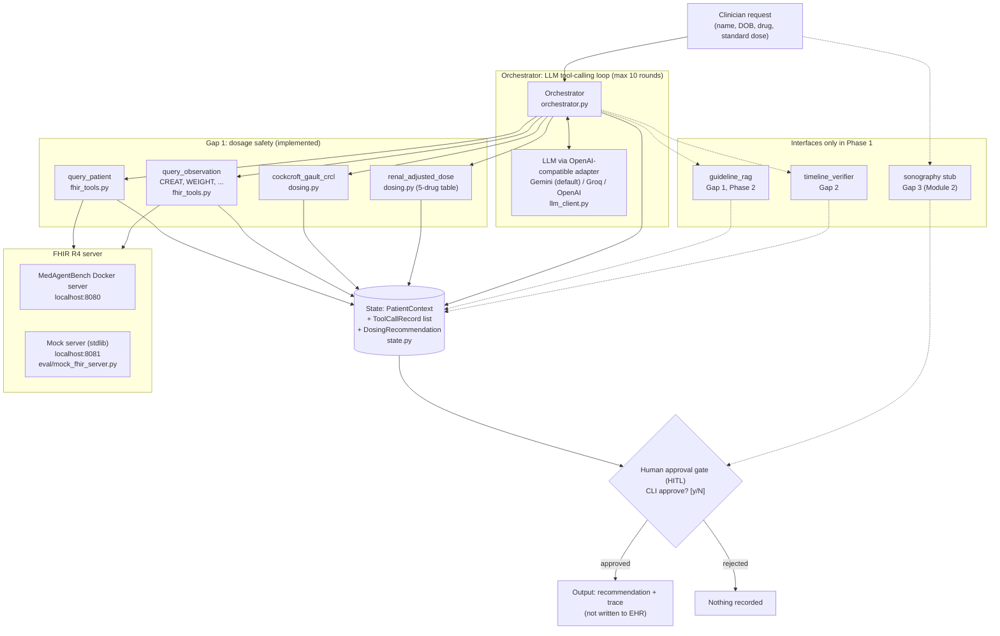
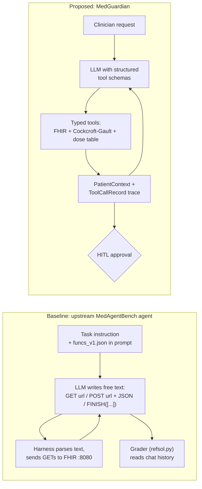

# MedGuardian architecture (Phase 1)

Phase 1 is a thin vertical slice. Gap 1 (renal dosing safety) runs end to end. Gap 2
(peri-operative process auditing) and Gap 3 (voice-driven sonography reporting) exist only as
interfaces that follow the same contracts.

A single orchestrator runs an LLM tool-calling loop (`src/medguardian/orchestrator.py`). The LLM is
reached through an OpenAI-compatible adapter (`src/medguardian/llm_client.py`); the default is Gemini
through its OpenAI endpoint, and Groq, OpenRouter, Ollama or OpenAI work by changing `LLM_BASE_URL`,
`LLM_MODEL` and the key. The LLM picks which tool to call next. Each tool reads or writes the shared
`PatientContext` and returns a `ToolCallRecord`. The final recommendation is held for a clinician
approval step and nothing is written back to the EHR.

## Main flow

Solid edges run in Phase 1. Dashed edges are planned; the stubs return `success=False` with a
"not implemented" error (or raise `NotImplementedError` for sonography) rather than made-up output.

## Baseline vs proposed

The baseline has no domain tools: the model must work out doses and lab logic in free text and its
POSTs are only graded, never applied. MedGuardian moves the arithmetic and the dosing rules into
deterministic, unit-tested tools, keeps every step in a typed state object, and stops at a human
approval step.

## Structured contracts

Defined in `src/medguardian/state.py`. Works on Python 3.9 and pydantic v1 or v2 (`to_dict()` helper).

| Model | Fields | Notes |
|---|---|---|
| `ToolCallRecord` | `call_id`, `tool_name`, `arguments`, `output`, `success`, `error`, `latency_ms`, `timestamp` | One record per tool call. `timestamp` and `call_id` use `default_factory`, so each record gets its own value. |
| `PatientContext` | `session_id`, `patient_id` (MRN), `name`, `birth_date`, `sex`, `age_years`, `weight_kg`, `serum_creatinine_mg_dl`, `crcl_ml_min`, `labs`, `recommendations`, `tool_calls`, `final_answer`, `requires_human_approval` (default `True`), `created_at` | Shared state for one run. `record()` appends a `ToolCallRecord`; `trace()` prints a readable trace. |
| `DosingRecommendation` | `drug`, `crcl_ml_min`, `band`, `adjusted_dose_mg`, `frequency`, `contraindicated`, `rationale`, `source` | Output of `renal_adjusted_dose`; `source` names the label/guideline. |

Tool contract: `tool(patient_context, **kwargs) -> ToolCallRecord`. The pure functions
(`cockcroft_gault_crcl(age_years, weight_kg, scr_mg_dl, sex) -> float`,
`renal_adjusted_dose(drug, crcl_ml_min, standard_dose_mg) -> dict`) are kept separate and unit-tested;
thin adapters (`crcl_tool`, `dose_tool`, `query_patient`, `query_observation`) wrap them for the
orchestrator. The stubs (`guideline_rag`, `timeline_verifier`) use the same signature.

## Gaps

| Gap | Module | Phase 1 status | Code |
|---|---|---|---|
| Gap 1: dosage safety | Module 1 | Implemented (FHIR tools, Cockcroft-Gault, 5-drug renal table, orchestrator, HITL placeholder) | `src/medguardian/` |
| Gap 1: guideline grounding | Module 1 | Stub | `src/medguardian/tools/stubs.py::guideline_rag` |
| Gap 2: peri-operative process audit | Module 1 | Stub | `src/medguardian/tools/stubs.py::timeline_verifier` |
| Gap 3: voice-driven sonography reporting | Module 2 | Stub (data contract only) | `src/sonography/stub.py` |

## Limitations

- The dosing table covers 5 drugs only (metformin, enoxaparin, gabapentin, levetiracetam, dabigatran).
  Unknown drugs return an error instead of a guess.
- Band edges and doses were taken from the FDA labels and KDIGO 2022 at the time of writing. They must be
  re-checked against current labels before being treated as ground truth.
- Metformin's label uses eGFR; we use Cockcroft-Gault CrCl as a surrogate.
- Levetiracetam's label bands are BSA-normalised (mL/min/1.73 m²); we apply them to unnormalised CrCl.
- Cockcroft-Gault uses total body weight; no adjustment for obesity or unstable renal function.
- No EHR writes. Approval is a CLI yes/no placeholder; nothing is recorded after approval.
- The mock FHIR server only serves our synthetic seed patients. On the live MedAgentBench server,
  weight may be missing and has to come from the case context.
